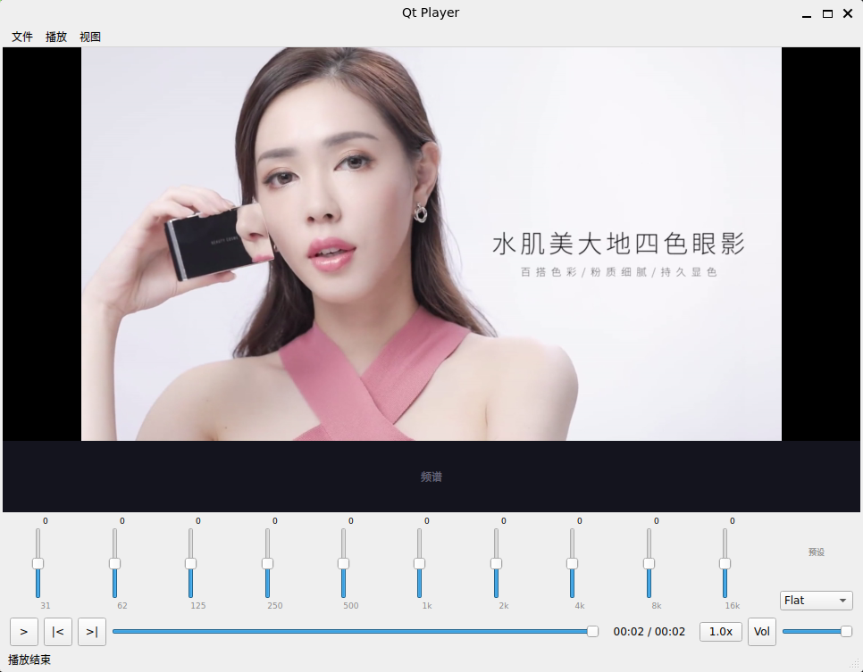

# Qt Player - FFmpeg/Qt6 桌面媒体播放器

[](https://github.com/Awrhs/qt_player/actions/workflows/ci.yml)

基于 FFmpeg 和 Qt6 的桌面媒体播放器，完整实现「解复用 → 解码 → 同步 → 渲染」播放管线，
集成 DXVA2 硬件解码、保持音调的倍速播放、音频频谱可视化和 10 段均衡器。

## 功能特性

### 播放控制
- ✓ 本地文件播放：MP4 / MKV / TS / FLV / AVI / MOV / WebM 等容器，H.264 / H.265 / MPEG-4 / AAC / MP3 / FLAC 等编码
- ✓ 网络流（HTTP(S) / RTSP 等 FFmpeg 支持的 URL）
- ✓ 打开方式：菜单、命令行参数、拖放文件到窗口、输入 URL
- ✓ 播放 / 暂停 / 停止；停止后按空格重新播放
- ✓ 精确 seek：进度条点击 / 拖动（拖动时实时预览时间），键盘 ←/→ ±5s、Ctrl+←/→ ±30s；
  落到关键帧后自动丢弃目标点之前的音视频数据，音频按样本精度裁剪到目标点
- ✓ 暂停态 seek 保持暂停并显示目标画面（可用于逐帧定位）
- ✓ 倍速 0.5x ~ 2.0x（libavfilter `atempo`，**变速不变调**，切换无需重建音频设备，音画保持同步）
- ✓ 逐帧前进 / 后退（真正的上一帧 / 下一帧；播放中按逐帧会先暂停）
- ✓ 循环播放（到达末尾自动从头继续）
- ✓ 自然播放结束进入末帧暂停态；再次播放从头开始
- ✓ 音量 0~100% + 静音，↑/↓ 键调节
- ✓ 全屏（双击画面 / F / F11，Esc 退出）
- ✓ 断点续播：中途退出的文件下次打开自动从上次位置继续
- ✓ 容器 start_time 归一化：进度条/时间从 0 开始显示（TS 等起始时间戳非 0 的文件）

### 音视频同步
- ✓ 统一主时钟 `MediaClock`：有音频时由音频设备交付进度驱动（扣除设备缓冲延迟），
  无音频时按墙上时钟推进；seek / 变速后时钟自动跟随真实播放位置
- ✓ 视频按时钟提前等待 / 落后丢帧（后继帧已到期才丢当前帧，追赶迅速且不误丢）
- ✓ 音频数据饥饿时时钟停表（视频不会跑到音频前面）
- ✓ 无可用声卡（无声卡 / CI / 设备被占用）时自动退化为“空音频设备”，视频照常播放

### 硬件解码
- ✓ DXVA2 硬件解码（回读模式，Windows）
- ✓ 硬解初始化失败自动回退软解
- ✓ 软解多线程（按 CPU 数自动）

### 音频增强
- ✓ 24 段频谱柱状图（自实现 2048 点基-2 FFT）
- ✓ 10 段 ISO 均衡器（RBJ 峰值滤波器，±12dB）
- ✓ 5 种预设：Flat / Pop / Rock / Classical / Jazz

### 其他
- ✓ 多线程架构（解复用 / 音频解码 / 视频解码分离，ffplay 风格 serial 代际 seek）
- ✓ 解复用背压控制（按已缓冲时长 / 字节数，所有流都充足才暂停读包，不互锁）
- ✓ 错误安全：坏文件不崩溃，关闭/切换文件可打断阻塞的网络 I/O
- ✓ GitHub Actions 持续集成：Linux（Release + ASan/UBSan）与 Windows（MSYS2）构建，
  单元测试 + 无头端到端播放测试

## 快捷键

| 操作 | 快捷键 |
|---|---|
| 打开文件 / 打开 URL | Ctrl+O / Ctrl+U |
| 播放 / 暂停 | Space |
| 停止 | S |
| 快退 / 快进 5 秒 | ← / → |
| 快退 / 快进 30 秒 | Ctrl+← / Ctrl+→ |
| 上一帧 / 下一帧 | , / . |
| 减速 / 加速 / 正常速度 | [ / ] / Backspace |
| 循环播放 | L |
| 静音 | M |
| 音量 + / − | ↑ / ↓ |
| 全屏 / 退出全屏 | F 或 F11 / Esc（双击画面也可切换） |
| 退出 | Ctrl+Q |

## 构建步骤

### 环境要求

| 组件 | 版本 |
|---|---|
| CMake | ≥ 3.16 |
| C++ 编译器 | GCC ≥ 11 / MSVC 2022 / Clang ≥ 14 |
| Qt | ≥ 6.4（Widgets + Multimedia） |
| FFmpeg | ≥ 5.1（libavformat / libavcodec / libavutil / libswresample / libswscale / **libavfilter**） |

### Windows (MSYS2 UCRT64 / MINGW64)

```bash
# UCRT64 环境（推荐；MINGW64 环境把前缀换成 mingw-w64-x86_64- 即可）
pacman -S mingw-w64-ucrt-x86_64-gcc mingw-w64-ucrt-x86_64-cmake mingw-w64-ucrt-x86_64-ninja \
          mingw-w64-ucrt-x86_64-pkgconf mingw-w64-ucrt-x86_64-qt6-base \
          mingw-w64-ucrt-x86_64-qt6-multimedia mingw-w64-ucrt-x86_64-ffmpeg

cd qt_player
cmake -B build -G Ninja
cmake --build build

./build/qt_player.exe <media_file>
```

### Windows (Visual Studio)

```powershell
# 安装 Qt6 for MSVC + FFmpeg dev SDK（含 avfilter）
set CMAKE_PREFIX_PATH=C:\Qt\6.7.0\msvc2022_64
cmake -B build -G "Visual Studio 17 2022" -DFFMPEG_DIR=C:\path\to\ffmpeg-dev
cmake --build build --config Release
```

### Linux

```bash
sudo apt install build-essential cmake ninja-build pkg-config \
    qt6-base-dev qt6-multimedia-dev libqt6multimedia6 libgl1-mesa-dev \
    libavformat-dev libavcodec-dev libavutil-dev libswresample-dev \
    libswscale-dev libavfilter-dev

cmake -B build -G Ninja
cmake --build build
./build/qt_player <media_file>
```

> **注意**：Linux 不支持 DXVA2（Windows 独占），硬解开关将不可用。

### 测试

```bash
cmake -B build -DBUILD_TESTS=ON
cmake --build build
QT_QPA_PLATFORM=offscreen ctest --test-dir build --output-on-failure
```

| 测试 | 覆盖 |
|---|---|
| test_bounded_queue / test_packet_queue / test_pcm_queue | 线程安全队列、seek 代际、PCM 媒体时间核算 |
| test_fft / test_equalizer | 频谱 FFT、均衡器 |
| test_media_clock | 主时钟：waiting / 停表 / 暂停 / 变速连续性 |
| test_audio_pipeline | atempo 变速输出量与媒体时间、seek 样本裁剪、格式转换、运行中变速 |
| test_audio_output | 时钟锚定、延迟补偿、饥饿停表、EOF、seek 代际、背压唤醒 |
| test_player_headless | 用 ffmpeg 生成测试片，端到端验证打开 / 播放 / seek / 暂停 seek / 逐帧 / 倍速 / 结束 / 循环 / 停止（需 `ffmpeg` 可执行文件，缺失时跳过） |

本机资源有限时，直接推送到 GitHub 由 Actions 完成构建与测试（见 `.github/workflows/ci.yml`）。

## 架构概述

### 线程模型

```
┌─ 主线程（Qt UI）────────────────────────────┐
│ MainWindow / 渲染定时器（按下一帧到期时间调度）  │
│  ├─ 取帧 → 与 MediaClock 比较 → 等待/丢帧/上屏  │
│  ├─ 结束判定（EOF + 队列排空 + 位置到末尾）      │
│  └─ 循环模式：到末尾自动 seek 回起点            │
│ SpectrumWidget (33ms)                        │
└──────────┬───────────────────────────────────┘
           │ seek 请求（条件变量唤醒）
┌──────────▼───────────────────────────────────┐
│ DemuxThread                                  │
│   av_read_frame → PacketQueue(音) / (视)       │
│   seek：av_seek_frame(默认流) → serial+1       │
│         → 清队列 → AudioOutput.flush → 时钟置位  │
│   EOF → nullptr 哨兵                           │
├──────────────────────────────────────────────┤
│ AudioDecodeThread                            │
│   serial 变化 → flush 解码器                   │
│   解码 → AudioPipeline(aformat→atempo)         │
│        → 丢弃/裁剪目标点前样本 → EQ → PCM 队列   │
├──────────────────────────────────────────────┤
│ VideoDecodeThread                            │
│   serial 变化 → flush 解码器 + pre-roll 阈值    │
│   解码（软/硬）→ 丢弃结束于目标点前的帧 → 帧队列  │
└──────────────────────────────────────────────┘
音频设备回调 / 空设备定时器：PcmQueue.pull → MediaClock.update(媒体时间 − 设备延迟)
```

### 数据流

```
文件/URL → AVIOContext → av_read_frame → AVPacket → PacketQueue(serial)
→ AVCodecContext → AVFrame
音频 → abuffer → aformat(flt/stereo/设备采样率) → atempo(倍速) → PcmChunk{pts, tempo}
     → Equalizer(10 biquad) → PcmQueue(≈250ms, 背压) → QAudioSink
     └→ SpectrumAnalyzer(FFT 2048 → 24 bands)
视频 → 帧队列 → MediaClock 同步 → sws_scale(YUV→RGBA, 直接缩放到显示尺寸) → QImage → paintEvent
EOF → nullptr 哨兵 → 解码器 drain → 滤镜图 flush → 队列排空 → 位置到末尾 → 暂停（或循环）
```

### 关键类

| 类 | 职责 |
|---|---|
| PlayerController | 状态机 + 线程管理 + seek 代际 + 同步/结束/循环逻辑 |
| Demuxer | AVFormatContext 封装、最佳流选择、单次 seek、中断回调 |
| Decoder | 软/硬解码器封装（多线程软解、DXVA2 回读） |
| PacketQueue | 带 serial 的包队列，统计时长/字节用于背压 |
| AudioPipeline | libavfilter 图：格式转换 + atempo 变速 + seek 样本裁剪 + 媒体时间核算 |
| PcmQueue | 有界 PCM 队列（按帧数限容），块携带媒体时间与倍速 |
| AudioOutput | QAudioSink 输出 / 空设备回退、驱动主时钟、音量 |
| MediaClock | 统一主时钟（waiting / 停表 / 暂停 / 变速） |
| VideoRenderer | sws_scale → QImage，对齐 stride 防 SIMD 越界 |
| Equalizer | 10 段 RBJ IIR 级联，原子切换无爆音 |
| SpectrumAnalyzer | 自实现 FFT + 24 段对数分档 |
| ClickableSlider | 支持点击定位的自定义滑块 |
| ResumeManager | QSettings 断点持久化 |

## 项目结构

```
qt_player/
├── CMakeLists.txt
├── .github/workflows/ci.yml   # Linux / ASan / Windows 构建与测试
├── src/
│   ├── main.cpp
│   ├── core/          # 播放内核
│   │   ├── BoundedQueue.h
│   │   ├── PacketQueue.h
│   │   ├── PcmQueue.h
│   │   ├── MediaClock.h/cpp
│   │   ├── Demuxer.h/cpp
│   │   ├── Decoder.h/cpp
│   │   ├── VideoRenderer.h/cpp
│   │   ├── AudioPipeline.h/cpp
│   │   ├── AudioOutput.h/cpp
│   │   ├── Equalizer.h/cpp
│   │   ├── SpectrumAnalyzer.h/cpp
│   │   └── PlayerController.h/cpp
│   ├── network/        # 网络流（滑动窗口缓存，预留）
│   ├── ui/             # 用户界面
│   │   ├── ClickableSlider.h
│   │   ├── MainWindow.h/cpp
│   │   ├── VideoWidget.h/cpp
│   │   ├── SpectrumWidget.h/cpp
│   │   ├── EqualizerPanel.h/cpp
│   │   └── PlaybackControls.h/cpp
│   └── utils/          # 工具
│       ├── Log.h/cpp
│       └── ResumeManager.h/cpp
├── tests/
└── README.md
```

## 设计决策

| 决策 | 选择 | 理由 |
|---|---|---|
| seek 机制 | ffplay 风格 serial 代际 | seek 时旧包/帧/PCM 带旧代际自然丢弃，解码器由自身线程 flush，无跨线程竞态 |
| 倍速 | libavfilter atempo + 运行时命令 | 变速不变调；无需重建设备；PCM 块携带 tempo 使时钟换算精确 |
| 主时钟 | PCM 块携带媒体时间，设备交付时锚定 | seek / 变速 / 饥饿后时钟自动跟随真实播放位置，不靠“目标点 + 样本计数”推算 |
| 精确 seek | 目标点前整帧丢弃 + 音频样本裁剪 | 起播点与进度条一致，暂停态 seek 显示正确的那一帧 |
| 渲染方式 | QWidget + QImage | 实现简单 |
| 渲染调度 | 单次定时器按下一帧到期重排 | 比固定周期轮询更省 CPU、抖动更小 |
| 硬解路线 | DXVA2 回读模式 | 编码简单；v2 可升级 D3D9 互操作 |
| 无声卡 | 空音频设备（定时器消费 PCM） | 视频在任何机器上都能播放，CI 可做端到端测试 |

## 许可

本项目基于 GPLv3 许可发布。

FFmpeg 是 LGPL/GPL 许可的第三方库。Qt 是 LGPL 许可的第三方库。

## 效果图


